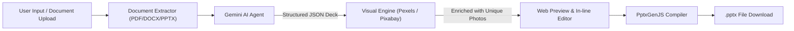

<div align="center">

# ⚡ FlyPtx
### AI Agent Presentation Generator

**Transform raw prompts and complex documents into executive-ready PowerPoint decks in seconds.**  
Powered by **Google Gemini**, **PptxGenJS**, and intelligent real-time stock photography.

---

[](https://nodejs.org/)
[](https://expressjs.com/)
[](https://aistudio.google.com/)
[](https://gitbrent.github.io/PptxGenJS/)
[](LICENSE)

</div>

---

## ✨ Features

- 📄 **Multi-Format Document Ingestion**  
  Upload **PDF, Word (`.docx`), PowerPoint (`.pptx`), Markdown, CSV, TXT, HTML, JSON, or RTF**. FlyPtx extracts the core content and structures it into executive slide narratives automatically.

- 🤖 **State-of-the-Art Gemini Agent**  
  Utilizes Google's latest **Gemini 3.5 Flash-Lite**, **Gemini 3.5 Flash**, **Gemini 3.8 Flash**, and **Gemini 3.1 Pro** with zero-downtime automatic fallback chains.

- 🖼️ **Visual Intelligence & Stock Photography**  
  Integrates with **Pexels** and **Pixabay** APIs. Features automatic Indonesian-to-English visual translation, stop-word filtering, and **guaranteed zero duplicate photos** across all slides in a presentation.

- ✏️ **Interactive In-Browser Slide Editor**  
  Preview your slides in a sleek Gamma-inspired card interface. Edit titles, bullets, cards, and key metrics directly before exporting.

- 📊 **Native PowerPoint Generation (`.pptx`)**  
  Outputs real vector shapes and text frames (not flat screenshots) with strict PowerPoint bounding box constraints and `autoFit / shrinkText` to prevent text overflow. 100% compatible with Microsoft PowerPoint, Google Slides, and Apple Keynote.

- 💾 **Local Persistence & History**  
  Presentations and slide metadata are persisted locally (`generated/`) so your history survives server restarts.

- 🛡️ **Offline / Zero-Config Fallback**  
  Includes a smart built-in heuristic slide generator so the application still works gracefully even if an API key is not configured or during external network downtime.

---

## 🚀 Quick Start

### 1. Clone the repository
```bash
git clone https://github.com/your-username/flyptx-ai-agent.git
cd flyptx-ai-agent
```

### 2. Install dependencies
```bash
npm install
```

### 3. Configure environment variables
Copy the example environment file:
```bash
cp .env.example .env
```

Open `.env` and add your API keys:
```env
PORT=3000
GEMINI_API_KEY=your_gemini_api_key_here
PEXELS_API_KEY=your_pexels_api_key_here     # Optional
PIXABAY_API_KEY=your_pixabay_api_key_here   # Optional
```
> 💡 *Get a free Google Gemini API key at [Google AI Studio](https://aistudio.google.com/app/apikey).*

### 4. Start the server
```bash
# Production mode
npm start

# Development mode (with auto-reload)
npm run dev
```

Open your browser and navigate to:  
👉 **`http://localhost:3000`**

---

## 🏗️ Architecture



---

## 📁 Project Structure

```
├── public/                 # Frontend assets (Single Page Application)
│   ├── index.html          # Main UI, styling, and client-side interactions
│   └── drian-avatar.png    # User profile assets
├── services/               # Core application services
│   ├── geminiAgent.js      # AI Agent structuring, prompts & fallback chain
│   ├── imageService.js     # Stock photo lookup, translation & deduplication
│   └── pptGenerator.js     # PptxGenJS layout engine & PowerPoint styling
├── server.js               # Express server, file ingestion, & API endpoints
├── .env.example            # Sample configuration file
├── .gitignore              # Ignored files (secrets, node_modules, generated decks)
└── package.json            # Node.js project manifest & scripts
```

---

## 🎨 Supported Slide Layouts

1. **Title Hero (`title`)** — High-impact cover slide with badge, title, subtitle, and landscape photo.
2. **Split Narrative (`split_image_right` / `split_image_left`)** — Deep analytical narrative paired with high-resolution imagery.
3. **Card Grid 3 (`card_grid_3`)** — 3 distinct strategic pillars or comparative cards side by side.
4. **Stat Highlight (`stat_highlight`)** — Prominent quantitative metric, label, and takeaway card.
5. **Strategic Roadmap (`conclusion`)** — Executive action directives summarizing next steps.
6. **Two Column (`two_column`)** — Balanced side-by-side comparative points.

---

## 📄 License

This project is licensed under the [MIT License](LICENSE).
